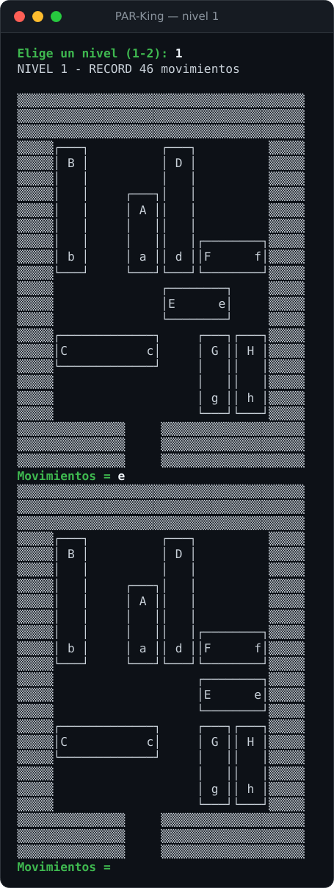

<div align="center">

# PAR-King

**Puzle de aparcamiento al estilo *Rush Hour* para terminal, en Python y sin dependencias externas**


<sub>Paradigmas de Programación · Grado en Ingeniería Informática · Universidad de Valladolid · Curso 2021-2022</sub>

</div>

Nivel 1 tal y como lo dibuja el programa, antes y después del movimiento `e`. Cada coche es una letra; el hueco del borde inferior es la salida.

<p align="center">
  
  <br>
  <sub>Salida real del programa.</sub>
</p>

## En pocas palabras

- **Reto**: representar un tablero de coches que se deslizan, validar cada movimiento y detectar cuándo se resuelve el nivel, todo en texto.
- **Solución**: un juego de terminal que carga niveles desde fichero, dibuja los coches con caracteres de recuadro, ejecuta secuencias de jugadas y guarda el récord de cada nivel.
- **Demuestra**: modelado de estado con matrices, formato de datos propio, detección de colisiones, persistencia en ficheros y diseño de la interacción por teclado.

## Lo más destacado

- **Formato de nivel propio**: cada coche cabe en cuatro caracteres (orientación `H`/`V`, columna, fila y longitud, por ejemplo `V322`) y cada nivel indica las coordenadas de su salida.
- **Render a escala**: cada casilla del tablero de 6x6 más el borde ocupa un bloque de 3 filas por 5 columnas en una matriz de 24x40, lo que permite dibujar cada coche como una caja con esquinas.
- **Colisiones sobre la propia representación**: antes de mover un coche se comprueba que la casilla destino de la matriz está vacía; un choque con otro coche o con el borde descarta la jugada.
- **Controles compactos**: la mayúscula mueve el coche a la izquierda o hacia arriba y la minúscula a la derecha o hacia abajo; una línea como `aBc` ejecuta varias jugadas seguidas.
- **Progresión y récords**: guarda el mejor número de movimientos de cada nivel en `records.txt` y desbloquea los niveles de uno en uno.

## Competencias

| Área | Qué se aplicó |
|------|---------------|
| Modelado de datos | Tablero como matriz de caracteres y coches como códigos de posición |
| Lógica de juego | Validación de movimientos, recuento de jugadas válidas y detección de la salida |
| Ficheros | Carga de niveles y lectura y escritura de récords en texto plano |

## Estructura del repositorio

```text
PAR-King-CLI/
├── PAR-King.py       # Programa completo
├── niveles.txt       # Niveles que carga el programa
├── records.txt       # Récord de movimientos por nivel
├── niveles1.txt      # Ficheros de niveles adicionales (no los carga el código)
├── niveles2.txt
├── niveles3.txt
└── jugadas.txt       # Fichero de datos auxiliar (no lo usa el código)
```

## Cómo ejecutarlo

Requiere Python 3 y una terminal con soporte Unicode. Ejecútalo desde la carpeta del repositorio, porque el programa abre `niveles.txt` y `records.txt` con rutas relativas:

```bash
python3 PAR-King.py
```

Al empezar, elige un nivel entre el 1 y el primero sin récord. Después escribe las jugadas y pulsa Intro. Al completar un nivel, el juego muestra los movimientos, avisa si es un nuevo récord y pregunta si quieres pasar al siguiente (`S`/`N`).

El juego modifica `records.txt` al conseguir un nuevo récord. Para jugar con otro conjunto de niveles, sustituye el contenido de `niveles.txt` por el de otro fichero con el mismo formato.

## Estado y limitaciones

- La entrada de jugadas no se valida: una letra que no corresponde a ningún coche del nivel detiene el programa con un `IndexError`.

## Autoría

Trabajo individual de Javier García González.

Existe una versión con interfaz gráfica en [PAR-King-GUI](https://github.com/JavivuG/PAR-King-GUI).

---

<div align="center"><sub>Parte de <a href="https://github.com/JavivuG/UVa-Projects">UVa-Projects</a> · Javier García González</sub></div>
